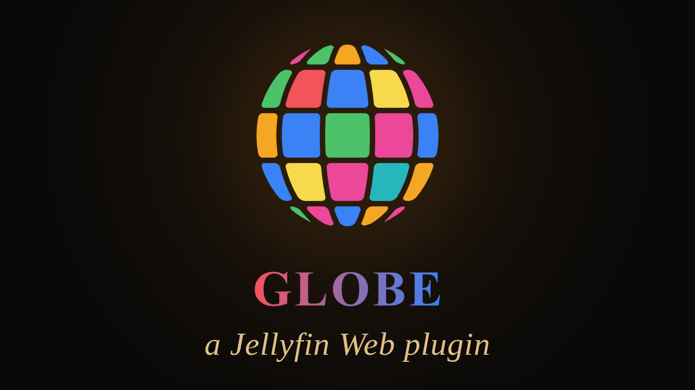

[Jellyfin Projects](https://linktr.ee/JellyfinProjects) | [Kodi Projects](https://linktr.ee/KodiProjects)

---



*Not affiliated with or endorsed by Jellyfin.*

---

Please also have a look at my other plugins:

- [ArtworkPlus](https://github.com/chrissix666/Jellyfin-ArtworkPlus): shows the artwork Jellyfin leaves unused
- [Cinema Project](https://github.com/chrissix666/Jellyfin-Cinema-Project): a virtual cinema environment based on three.js that gives your movies an ambient feel
- [VideoOSD Tweaks and Candy](https://github.com/chrissix666/Jellyfin-VideoOSD-Tweaks-Candy): puts you in full control of the Jellyfin video player OSD
- [Destroy](https://github.com/chrissix666/Jellyfin-Destroy): turns the Jellyfin page you are looking at into a game level
- [VisoMaster Bridge](https://github.com/chrissix666/Jellyfin-VisoMaster-Bridge): swaps faces in the film you are watching, with [VisoMaster Fusion](https://github.com/VisoMasterFusion/VisoMaster-Fusion)

---

# Jellyfin Globe

- [What This Is](#what-this-is)
- [What This Is Not](#what-this-is-not)
- [Under the Hood](#under-the-hood)
  - [Architecture](#architecture)
  - [The Image Store](#the-image-store)
- [Requirements](#requirements)
- [Installation](#installation)
- [Your First Globe](#your-first-globe)
- [Using the Globe](#using-the-globe)
- [General](#general)
  - [Double-Click](#double-click)
  - [Globes](#globes)
  - [Storage](#storage)
- [Globe Settings](#globe-settings)
  - [What Goes On](#what-goes-on)
  - [Pictures](#pictures)
  - [Ratings](#ratings)
  - [Order](#order)
  - [Look and Updates](#look-and-updates)
- [Home Videos and Photos](#home-videos-and-photos)
- [Games with Playnite Bridge](#games-with-playnite-bridge)
- [Updates and Tasks](#updates-and-tasks)
- [Parental Controls](#parental-controls)
- [Settings Management](#settings-management)
- [Settings Not Applying?](#settings-not-applying)
- [Limits](#limits)
- [Developed For & Tested On](#developed-for--tested-on)
- [Credits](#credits)
- [License](#license)

---

**Globe puts the artwork of your libraries on a globe you can turn and zoom like a map. Thousands of posters, backdrops, logos or photos on one sphere, sharp up close, and a double-click opens the title.**

---

## What This Is

A Jellyfin plugin that builds globes from your libraries. You choose the libraries, the artwork types and the order, and Globe lays every picture on a sphere: posters next to posters, backdrops next to backdrops, each in its own shape, without gaps.

A button in Jellyfin's header opens the globe over the page. Turn it with the mouse, zoom in with the wheel until a single poster fills the screen, and double-click to open the title, play it or watch its trailer. With two or more globes a side menu switches between them.

Movies, series, seasons, collections, home videos, photos, and with [Playnite Bridge](#games-with-playnite-bridge) also games.

https://github.com/user-attachments/assets/db069aed-1a68-4361-bcca-64800ada8192

---

## What This Is Not

Globe does not download artwork. It shows the pictures Jellyfin already has for your titles.

It does not change your media, your metadata or your libraries. It only reads them and writes its own data into its own folder.

It is not a player and not a library view. A double-click hands the title to Jellyfin, and Jellyfin's own detail page, player or photo viewer opens.

---

## Under the Hood

### Architecture

Globe is a native Jellyfin plugin.

The server part is written in **C#**. It picks the titles of each globe through Jellyfin's own queries, prepares every picture once, lays out the sphere and stores the result. Building runs in Jellyfin's scheduled task **Build Globe**, with progress in the task list.

The globe itself is drawn in the browser with [three.js](https://threejs.org) and WebGL 2. The sphere is cut into rings, every ring into columns, every column into tiles. From far away the globe uses small compressed pages of all pictures; when you zoom in, the sharp pictures of the tiles in view are fetched in bundles.

The header button and the layer are added to Jellyfin Web through the File Transformation plugin.

### The Image Store

All globes share one image store. Every picture is prepared once in three sizes and kept in a file per artwork type; a globe only points into it. Two globes with the same posters need the room for those posters once.

When a globe is deleted, its pictures are freed and their room is used again by the next pictures. **Compact** rewrites the store without the freed room.

---

## Requirements

- Jellyfin 10.10.7 or 12.0+
- The [File Transformation Plugin](https://github.com/IAmParadox27/jellyfin-plugin-file-transformation)
- A desktop browser with WebGL 2 and S3TC texture compression, on a graphics card that takes textures 16384 pixels wide. On a device without them the globe button does not appear.

A word on Jellyfin versions: the plugin comes as two builds, 1.x for 10.10.7 and 2.x for 12.0+. It is one and the same source, and Jellyfin's plugin catalog automatically offers the one that matches your server. Versions in between (like 10.11) are untested.

---

## Installation

Requires the [File Transformation Plugin](https://github.com/IAmParadox27/jellyfin-plugin-file-transformation) to be installed first.

**Via Plugin Catalog (recommended)**

1. In Jellyfin, go to Dashboard > Plugins > Repositories
2. Add a new repository:
   - **Name:** anything you like, for example `Globe`
   - **URL:**

```
https://raw.githubusercontent.com/chrissix666/Jellyfin-Globe/main/manifest.json
```

3. Go to the Catalog tab, find Globe (category: Experimental), and install it
4. Restart Jellyfin
5. Continue with [Your First Globe](#your-first-globe)

**Manual Installation**

1. Download the latest release ZIP from the [Releases page](https://github.com/chrissix666/Jellyfin-Globe/releases), the one for your Jellyfin version: 1.x for Jellyfin 10.10.7, 2.x for Jellyfin 12.0+
2. Extract the whole ZIP into its own folder inside your Jellyfin plugins folder, for example `plugins/Globe`
3. Restart Jellyfin
4. Continue with [Your First Globe](#your-first-globe)

---

## Your First Globe

1. Open Dashboard > Plugins > Globe, tab **Globes**.
2. Click **Create Globe**, open it, tick a library and an artwork type, for example your movies and Poster.
3. Click **Save**. The globe is built right away; the status line shows the progress.
4. Reload Jellyfin Web. The globe button sits in the header.

The first build reads every picture once and can take a while for a large library. Later builds only read what is new.

---

## Using the Globe

- **Turn:** drag with the mouse.
- **Zoom:** the mouse wheel. Close up, the sharp pictures load for the tiles in view.
- **Right-click** a tile: the globe turns to it and zooms in until it fills the screen.
- **Double-click** a tile: what the admin set for its media type, see [Double-Click](#double-click).
- **Close:** the X, Esc or Back.
- **Switch globes:** the small tab below the X opens the side menu, with the build progress of each globe.

The poles carry the Jellyfin logo on the globe's colour. When the detail page, the player or the photo viewer opens, the globe steps aside, and it comes back with the same view when you return.

Animated artwork (animated WebP or GIF) is shown with its first frame on the globe. When the globe turns to such a tile and it is large enough, the animation plays over the tile until you turn away.

---

## General

### Double-Click

What a double-click does, per media type:

| Media type | Choices | Default |
|---|---|---|
| Movie | Detail Page, Play, Trailer | Detail Page |
| Movie Without Trailer | Detail Page, Play (when Trailer finds none) | Detail Page |
| Series | Detail Page, Play | Detail Page |
| Season | Detail Page, Play | Detail Page |
| Collection | Detail Page, Play | Detail Page |
| Home Video | Detail Page, Play | Detail Page |
| Photo | Photo Viewer, Detail Page | Photo Viewer |
| Game (with Playnite Bridge) | Detail Page, Play, Open in Playnite | Detail Page |

Play starts the title in Jellyfin's own player. Trailer plays the movie's own trailer, else one from the internet in a new tab.

### Globes

- **Globe on Opening:** the globe the header button opens first, or the one used last.
- **Play Animated Artwork:** on by default; only matters when animated artwork is used.
- **Update All Automatically:** ticks or clears Update Automatically on every globe at once.
- **Compact on Update:** the automatic update compacts the image store once a quarter of it is free. Off by default.

### Storage

- **Data Folder:** where the globes and the image store live. Empty means Jellyfin's metadata folder. The folder must be empty or already hold Globe's data of this server. After a change every globe is built anew in the new folder; the old folder stays until you delete it.
- **Globe Data:** the size of all globe data and how much of it is free. **Compact** frees that room, as a task.
- **Old Data Folder:** shown after a change of the data folder. **Delete** removes only Globe's own data there.

---

## Globe Settings

Every globe has its own settings on the **Globes** tab. Each row shows the globe's name, media types, artwork types, number of images and size ("1.2 GB, 300 MB only this globe", as globes share pictures).

### What Goes On

- **Libraries:** the libraries the globe shows. A globe can mix them.
- **Artwork Types:** Poster, Backdrop, Thumb, Logo, Clearart, Banner, Disc. Each title brings the types it has.
- **Include Children:** seasons join their series and movies join their collection.
- **Collection Titles Alone:** with children, a movie of a collection also stands on its own.
- **Backdrops:** Main Backdrop, All, All Except Main, or chosen numbers like `2-5, 8`.

### Pictures

- **Black Bars:** Remove (default) or Keep. Remove finds burned-in black bars: side bars get a blurred fill, bars above and below are cut away. Logos, clearart and discs are left as they are.
- **Picture Fit** (home videos and photos) and **Cover Fit** (game covers): Crop, Own Shape, Blur Fill or Adaptive.
  - Crop cuts the picture to the tile's shape.
  - Own Shape keeps the picture's shape (2:3, 3:4, 1:1, 4:3, 3:2 or 16:9).
  - Blur Fill shows the whole picture on a blurred fill.
  - Adaptive crops a picture that loses at most the **Crop Limit** (default 15 %) and shows any other on the blurred fill.

### Ratings

- **Highest Rating:** titles above it stay off the globe. The list is Jellyfin's own.
- **Leave Out Unrated:** titles without a parental rating stay off.

### Order

- **Sort:** the sort options that all chosen libraries share (name, date added, release date, community rating, parental rating and the like), and Random.
- **Sort Order:** ascending or descending.
- **Cluster:** with Random, the artwork of a title stays together.
- **Reshuffle:** when a random globe is mixed anew although its titles stayed the same: on the automatic update (default), on every update, or never.
- **Start:** the first title in the middle of the screen, or at the top of the globe.

### Look and Updates

- **Color:** the background and the colour that shows through transparent artwork.
- **Update Automatically:** the task Build Globe checks this globe. Off by default.
- **Update** and **Delete** per globe; **Update All** above the list.

---

## Home Videos and Photos

For a home video library, a globe chooses **Videos**, **Photos** or both, and its folders: **Only Ticked Folders** or **All Except Ticked Folders**, at any depth. Every photo comes with its own picture, a video with **Poster** ticked, and each fits its tile by **Picture Fit**. Photos turned by their camera keep their right orientation.

---

## Games with Playnite Bridge

With the Playnite Bridge plugin installed, its games library can go on a globe like any other, also mixed with movies.

- **Versions:** the main version of each game (default) or every version.
- **Keep Versions Together:** the versions of a game stand at the place of its main version.
- **Discs:** First Disc, All, All Except First or chosen numbers. Two disc files with the same picture count once. A movie keeps its one disc.
- **Cover Fit:** see [Pictures](#pictures).
- Game collections work like movie collections, with Include Children.
- Rating limits hold for games too, by the strictest age rating of the game, whatever Playnite Bridge's own parental setting is.
- A double-click on a game opens its detail page, starts or installs it, or opens it in Playnite, see [Double-Click](#double-click).

Without Playnite Bridge the game settings are hidden. A globe with games keeps its games as built and says "Playnite Bridge missing" until the bridge is back.

---

## Updates and Tasks

Globe adds two scheduled tasks under Dashboard > Scheduled Tasks:

- **Build Globe** runs the updates. Run by hand or by a schedule, it is the automatic update: it checks the globes with **Update Automatically** ticked. By default it has no schedule; set one there if you want globes to follow your libraries by themselves.
- **Compact Globe Storage** compacts the image store.

An update builds a globe only when something changed: a title, a picture or a setting. Changed settings rebuild the globe after saving.

A globe never comes out empty by accident. When the folders of one of its libraries cannot be reached, for example a disk that sleeps or is unplugged, the globe keeps its last build and the status line says why; the next update tries again.

---

## Parental Controls

Globe follows Jellyfin's parental controls per user:

- A user sees a globe only when every library of it is visible to them.
- A user with a parental limit sees only globes whose **Highest Rating** is within that limit.
- A user who blocks unrated items sees only globes without such items, for example with **Leave Out Unrated**.
- A user with blocked or allowed tags sees no globe.

Admins create the globes; every user who may see one gets the button.

---

## Settings Management

Every setting lives under Dashboard > Plugins > Globe, in three tabs: General, Globes and Credits.

### Restore Defaults

The General tab has a **Restore defaults** button in the top right corner. It resets the general settings to their default values. Click **Save** afterwards to keep them.

### Backup and Restore (All)

The General tab also includes a code-based backup system. **Generate** creates a compact code that represents your complete current settings, globes included, **Copy to clipboard** copies it. Store it somewhere safe. **Import** lets you paste that code back at any time to restore your full configuration, for example after a reinstall or when moving to a new server. After importing, click **Save all settings**. If a library or folder of the code is not on this server, the import says so, and you choose it again.

### Uninstalling

Uninstalling leaves the globe data in the data folder. To remove it too, click **Delete All** on the Globes tab before you uninstall.

---

## Settings Not Applying?

Every once in a while, a saved setting doesn't seem to take effect right away, even after saving and reloading. To be explicit about this: **this is not a bug in Globe**, it's normal browser caching behavior. Your browser can hang onto an old cached copy of the page or script instead of fetching the new one, and this same thing can happen with other Jellyfin plugins and addons too, not just this one; it's just how browsers work, not something specific to this plugin.

If that happens: open your browser's DevTools (right-click anywhere, **Inspect**), go to the **Network** tab, and check **Disable cache**. Leave DevTools open, don't close it, then refresh the page and open the plugin settings again. With DevTools open and that box checked, the browser is forced to fetch everything fresh instead of reusing anything cached.

**Fixing settings that aren't applying: disable cache workaround**


---

## Limits

- **Desktop browsers.** The globe needs WebGL 2, S3TC textures and 16384-pixel textures; phones and most TV devices do not have them, and there the button does not appear.
- **Jellyfin Web only.** The button and the globe are drawn by a script in Jellyfin Web. Apps that do not load the server's Jellyfin Web page do not show them.
- **The first build of a large globe takes time.** Every picture is read once; the next builds reuse them.
- **A globe is a snapshot.** It shows the titles of its last build; new titles come with the next update.
- **No sort by plays.** A globe is the same for every user, so there is no sort by date played or play count.

---

## Developed For & Tested On

- Designed and written for Jellyfin Web 10.10.7 and 12.0+
- Google Chrome
- Windows 11

Other versions may work but are not tested and could lead to unexpected behavior.

---

## Credits

- [three.js](https://threejs.org) (revision 160), by the three.js authors, MIT License
- Jellyfin logo on the poles: [Jellyfin artwork](https://github.com/jellyfin/jellyfin-ux), CC BY-SA 4.0
- Movie, series, game and photo artwork belongs to its respective owners

---

## License

MIT License

Forking and further development strongly encouraged.
Feedback and bug reports welcome, feel free to open an issue.

---
